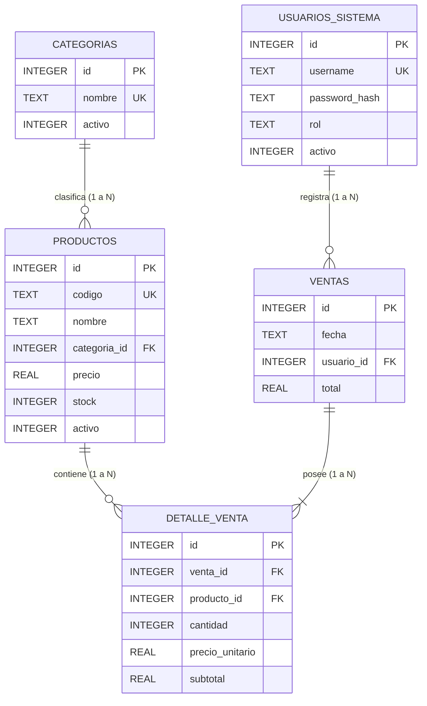

# Mini Punto de Venta e Inventario (Tkinter + SQLite3)
**Materia:** Tópicos Avanzados de Programación · Unidad 1 (Proyecto Final)  
**Opción Elegida:** Opción 2 — Inventario / Mini punto de venta  
**Estudiante:** José Alberto Escorcia  
**Usuario de GitHub:** `josealbertohescorcia-boop`  
**Repositorio:** `tap-u1-punto-de-venta`  
**URL del Repositorio:** `https://github.com/josealbertohescorcia-boop/tap-u1-punto-de-venta`

---

## 1. Descripción del Proyecto

Esta aplicación de escritorio resuelve de forma integral el control de existencias y el registro de ventas para pequeños comercios, papelerías, cafeterías o tiendas escolares. Permite a los cajeros y administradores clasificar mercancías por categorías, controlar inventarios con alertas automáticas de existencias mínimas o críticas, emitir folios de venta multi-producto con cálculo automático de totales y generar reportes analíticos con opción de exportación a hojas de cálculo en formato CSV, garantizando la consistencia y la integridad transaccional de los datos en todo momento.

---

## 2. Requisitos del Sistema

* **Lenguaje:** Python 3.10 o superior (Probado y compatible con Python 3.10, 3.11, 3.12, 3.13 y 3.14).
* **Librerías Obligatorias:** Utiliza 100% módulos de la biblioteca estándar de Python:
  * `tkinter` y `ttk` (Interfaz gráfica de usuario).
  * `sqlite3` (Persistencia relacional con llaves foráneas).
  * `hashlib` (Cifrado seguro de contraseñas con SHA-256).
  * `csv` (Exportación de reportes).
* **Dependencias:** Ver archivo [requirements.txt](requirements.txt). No se requiere instalación forzosa de librerías externas vía `pip` para su correcto funcionamiento.

---

## 3. Instalación y Ejecución Paso a Paso

Siga estos sencillos comandos en su terminal (PowerShell, CMD o Bash) para clonar y ejecutar el sistema desde cero:

### Paso 1: Clonar el repositorio
```bash
git clone https://github.com/JoseEscorcia/tap-u1-punto-de-venta.git
cd tap-u1-punto-de-venta
```
*(O simplemente abra la carpeta del proyecto en su editor favorito o terminal)*.

### Paso 2: Crear y activar un entorno virtual (opcional pero recomendado)
* En Windows:
  ```powershell
  python -m venv .venv
  .\.venv\Scripts\activate
  ```
* En macOS / Linux:
  ```bash
  python3 -m venv .venv
  source .venv/bin/activate
  ```

### Paso 3: Ejecutar la aplicación
```bash
python main.py
```
> **Nota de inicialización automática:** Al ejecutarse por primera vez, la aplicación creará automáticamente el archivo de base de datos `tienda.db` con todas sus tablas, restricciones de integridad y datos semilla de prueba (usuarios, categorías, productos y ventas históricas).

---

## 4. Usuarios de Prueba y Roles de Acceso (A.5)

El sistema cuenta con autenticación basada en hash SHA-256 y control de acceso basado en roles (RBAC):

| Usuario | Contraseña | Rol Asignado | Permisos y Alcance |
| :--- | :--- | :--- | :--- |
| **`admin`** | `admin123` | **Administrador** | Acceso total: Punto de Venta, Catálogos de Productos y Categorías, Historial con JOIN, Reportes con exportación CSV y **Módulo de Gestión de Cuentas de Personal**. |
| **`operador`** | `operador123` | **Operador** | Acceso operativo: Registrar ventas, consultar catálogos e historial y ver reportes. **No tiene acceso a la gestión de personal ni cuentas de usuarios**. |

---

## 5. Modelo de Datos Relacional

La base de datos relacional opera bajo SQLite 3 con la directiva `PRAGMA foreign_keys = ON;` activada en cada conexión.

### Diagrama Entidad-Relación:



### Descripción de las Tablas:
1. **`usuarios_sistema`**: Cuentas con contraseñas en hash SHA-256 y roles diferenciados (`administrador` y `operador`).
2. **`categorias` (Entidad B)**: Clasificación de productos (nombre único y borrado lógico por estado activo).
3. **`productos` (Entidad A)**: Catálogo de artículos con código único, precio positivo, existencias y relación con categorías.
4. **`ventas` (Encabezado del Movimiento)**: Folio general, fecha de operación en formato ISO (`YYYY-MM-DD HH:MM:SS`), cajero responsable y total cobrado.
5. **`detalle_venta` (Renglones del Movimiento)**: Artículos vendidos por folio, cantidad, precio unitario inmutable (congelado al momento de la venta) y subtotal.

---

## 6. Funcionalidades y Reglas de Negocio Implementadas

### Cumplimiento de Requisitos Funcionales (Rúbrica Oficial):
* **RF-1 (Creación automática):** El archivo `tienda.db` y su esquema se generan en la primera corrida.
* **RF-2 y RF-3 (Seguridad y Login):** Login obligatorio. Contraseñas protegidas mediante digest SHA-256. El operador no puede administrar cuentas de usuario.
* **RF-4 (CRUD Completo de Entidades):**
  * **Categorías:** Crear, listar con filtro, editar nombre, alternar estado activo/inactivo y eliminación controlada.
  * **Productos:** Crear con validación de tipos, listar con buscador en vivo, filtrar por categoría y estado, editar y desactivar.
* **RF-5 (Movimiento de Negocio / Punto de Venta):** Carrito multi-producto interactivo. Validación en tiempo real de existencias. Descuento atómico de existencias e inserción coordinada en una sola transacción (`BEGIN TRANSACTION / COMMIT`).
* **RF-6 (Búsqueda en Treeview):** Buscadores en vivo por texto en productos, categorías, ventas y reportes.
* **RF-7 (Consulta SQL con JOIN):**
  * Demostración en vivo en la pestaña *Historial (JOIN)* uniendo las tablas `detalle_venta`, `ventas`, `productos`, `categorias` y `usuarios_sistema`.
* **RF-8 (Reporte del Caso Problemático):** Módulo dedicado que identifica productos con stock bajo o crítico (≤ umbral parametrizable, por defecto 5 unidades) y productos más vendidos.
* **RF-9 (Confirmaciones):** Diálogos `messagebox.askyesno` antes de cualquier acción irreversible (borrados, desactivaciones, vaciado de carrito y confirmación de cobro).
* **RF-10 (Integridad Referencial):**
  * No se permite eliminar un producto que tenga ventas registradas en el historial (se ofrece y exige desactivarlo en su lugar).
  * No se permite eliminar ni desactivar una categoría si contiene productos activos vinculados.

### Extras Opcionales Implementados (A.6 - Rubro Extra +10 pts):
1. **Exportación a CSV:** Generación de archivos `.csv` con codificación UTF-8 con BOM compatible nativamente con Microsoft Excel para cualquier reporte visualizado.
2. **Estilizado Visual Moderno:** Tema `clam` personalizado con paleta de colores profesional, alertas con etiquetas visuales y tipografía optimizada.

---

## 7. Arquitectura en Capas y Estructura del Código

El proyecto cumple estrictamente con el principio de separación de responsabilidades (SoC) sin código SQL en la interfaz gráfica:

```
proyecto de programacion/
│
├── main.py                     # Punto de entrada de la aplicación y ciclo de vida
├── README.md                   # Documentación oficial del proyecto
├── requirements.txt            # Especificación de dependencias del entorno
├── .gitignore                  # Exclusión de archivos binarios, cache y temporales
├── tienda.db                   # Base de datos SQLite3 relacional generada
│
├── db/                         # Persistencia y conexión
│   ├── __init__.py
│   ├── connection.py           # Conexión SQLite con PRAGMA foreign_keys = ON
│   └── database.py             # DDL (CREATE TABLE) y carga de datos semilla (A.5)
│
├── models/                     # Entidades del dominio (POO puro sin Tkinter)
│   ├── __init__.py
│   ├── usuario.py              # Clase Usuario
│   ├── categoria.py            # Clase Categoria
│   ├── producto.py             # Clase Producto
│   ├── venta.py                # Clase Venta
│   └── detalle_venta.py        # Clase DetalleVenta
│
├── repositories/               # Acceso a datos (SQL puro y mapeo relacional a objetos)
│   ├── __init__.py
│   ├── usuario_repository.py   # Consultas sobre usuarios_sistema
│   ├── categoria_repository.py # Consultas y restricciones de categorías
│   ├── producto_repository.py  # Consultas, filtros y stock de productos
│   └── venta_repository.py     # Transacciones de venta y consultas JOIN complejas
│
├── services/                   # Reglas del negocio y validaciones
│   ├── __init__.py
│   ├── auth_service.py         # Login, sesiones y hashing SHA-256
│   ├── usuario_service.py      # Gestión de personal (solo admin)
│   ├── categoria_service.py    # Validaciones e integridad de categorías
│   ├── producto_service.py     # Validaciones de precio, código único e integridad
│   ├── venta_service.py        # Validaciones de carrito, stock y ejecución de venta
│   └── reporte_service.py      # Lógica de reportes y exportación CSV
│
├── ui/                         # Presentación gráfica (Tkinter / ttk)
│   ├── __init__.py
│   ├── styles.py               # Configuración de estilos globales, fuentes y paleta
│   ├── login_window.py         # Ventana de autenticación
│   ├── main_window.py          # Ventana principal con barra de menú y pestañas
│   ├── categoria_view.py       # Pestaña CRUD Categorías
│   ├── producto_view.py        # Pestaña CRUD Productos e inventario
│   ├── venta_view.py           # Pestaña Punto de Venta (Carrito y cobro)
│   ├── venta_historial_view.py # Pestaña Historial de movimientos con JOIN
│   ├── reporte_view.py         # Pestaña Reportes y Exportación CSV
│   └── usuario_view.py         # Pestaña Gestión de Usuarios (exclusiva admin)
│
└── docs/                       # Documentación técnica adicional y de defensa
    ├── diagrama_bd.md          # Especificación detallada de la base de datos
    ├── pantallas_referencia.md # Flujos y comportamiento de las pantallas
    └── guia_defensa.md         # Guía de preguntas y respuestas para la defensa en clase
```

---

## 8. Guía Rápida para la Defensa en Clase

Consulte el documento completo [docs/guia_defensa.md](docs/guia_defensa.md) para estudiar todas las respuestas técnicas detalladas:

1. **¿Dónde vive la regla de negocio y por qué no está en el botón?**  
   Viven en los archivos de `services/` (ej. `services/venta_service.py`). No están en los botones de `ui/` para evitar el acoplamiento con la librería gráfica, permitiendo que la lógica sea testeable, reutilizable e independiente de la vista.
2. **Muestre el JOIN y explique cada tabla:**  
   Se encuentra en `repositories/venta_repository.py` (método `listar_detalles_con_join`), cruzando `detalle_venta`, `ventas`, `productos`, `categorias` y `usuarios_sistema`.
3. **¿Qué pasa si intentan un movimiento que viola stock?**  
   El servicio lanza una excepción `ValueError`, la transacción de SQLite ejecuta un `ROLLBACK` automático para no alterar ninguna tabla y la UI muestra un mensaje amigable con `messagebox.showerror` sin cerrar la aplicación.
4. **¿Por qué desactivar en lugar de DELETE?**  
   Para proteger la integridad referencial y mantener el historial contable de ventas pasadas intacto (*soft delete*).
5. **Si mañana cambian SQLite por PostgreSQL, ¿qué archivos tocarían?**  
   Únicamente `db/connection.py`, `db/database.py` y los archivos de `repositories/`. La capa de interfaz (`ui/`), servicios (`services/`) y modelos (`models/`) permanecerían 100% idénticos.
