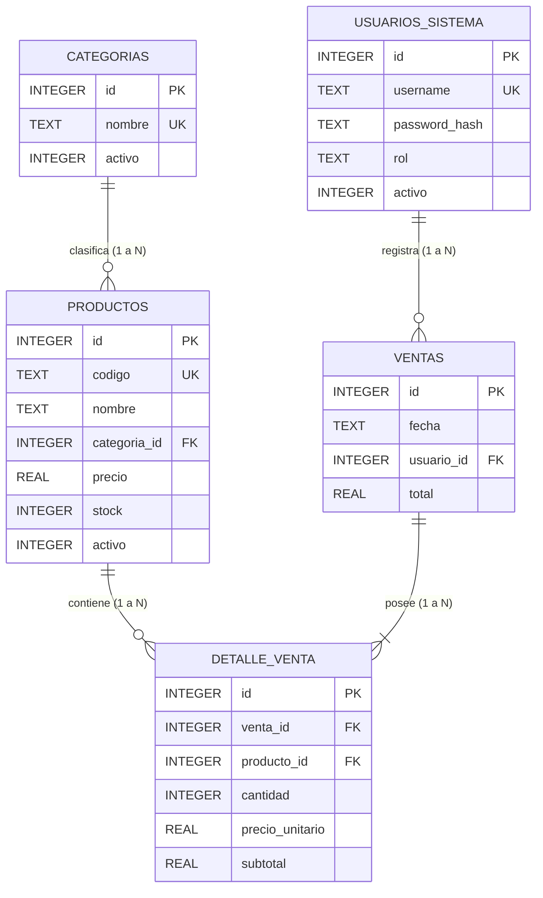

# Diagrama y Modelo de Base de Datos
**Opción 2: Inventario / Mini Punto de Venta**

El sistema utiliza persistencia relacional en **SQLite 3** con llaves foráneas estrictamente habilitadas (`PRAGMA foreign_keys = ON;`).

---

## 1. Diagrama Entidad-Relación (Mermaid)

---

## 2. Descripción de Tablas y Restricciones

### 1. `usuarios_sistema`
Representa los operadores y administradores que ingresan a la aplicación.
* `id`: Clave primaria autoincremental.
* `username`: Nombre de usuario único (`UNIQUE NOT NULL`).
* `password_hash`: Hash criptográfico SHA-256 de la contraseña (nunca en texto plano, cumple **RF-3**).
* `rol`: Rol con restricción `CHECK(rol IN ('administrador', 'operador'))`.
* `activo`: Estado de cuenta `CHECK(activo IN (0, 1))`.

### 2. `categorias` (Padrón / Entidad B)
Categorías para clasificación de mercancías.
* `id`: Clave primaria autoincremental.
* `nombre`: Nombre único de la categoría (`UNIQUE NOT NULL`).
* `activo`: Estado lógico `1 = activa`, `0 = inactiva`.

### 3. `productos` (Catálogo / Entidad A)
Artículos inventariados disponibles para venta.
* `id`: Clave primaria autoincremental.
* `codigo`: Código de barras o clave alfanumérica única (`UNIQUE NOT NULL`).
* `nombre`: Nombre o descripción comercial del producto.
* `categoria_id`: Clave foránea referenciando `categorias(id) ON DELETE RESTRICT`.
* `precio`: Precio de venta unitario actual (`REAL CHECK(precio > 0)`).
* `stock`: Existencias disponibles en bodega/tienda (`INTEGER CHECK(stock >= 0)`).
* `activo`: Estado lógico `1 = activo`, `0 = inactivo`.

### 4. `ventas` (Encabezado del Movimiento de Negocio)
Folios de venta generados en el punto de venta.
* `id`: Folio único de venta (`PRIMARY KEY AUTOINCREMENT`).
* `fecha`: Marca de tiempo en formato ISO estándar (`YYYY-MM-DD HH:MM:SS`).
* `usuario_id`: Clave foránea referenciando al cajero/vendedor en `usuarios_sistema(id)`.
* `total`: Importe total de la transacción (`REAL CHECK(total >= 0)`).

### 5. `detalle_venta` (Renglones del Movimiento de Negocio)
Artículos individuales asociados a un folio de venta.
* `id`: Clave primaria autoincremental del ítem.
* `venta_id`: Clave foránea referenciando a `ventas(id) ON DELETE CASCADE`.
* `producto_id`: Clave foránea referenciando a `productos(id) ON DELETE RESTRICT`.
* `cantidad`: Unidades vendidas (`INTEGER CHECK(cantidad > 0)`).
* `precio_unitario`: Precio al momento exacto de la venta (inmutable, congelado en el histórico).
* `subtotal`: `cantidad * precio_unitario`.
